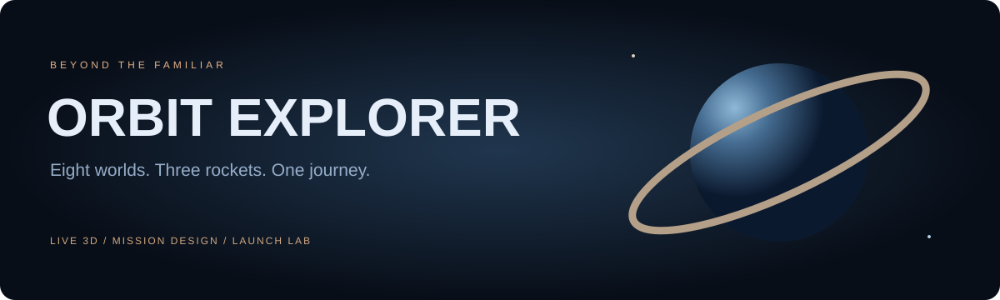

# ORBIT EXPLORER



[](https://github.com/berkayozdmr21/orbit-explorer/actions/workflows/ci.yml)


**Eight worlds. Three rockets. One continuous journey of curiosity.**

A full-stack, interactive space experience with procedural 3D planets, cinematic camera transitions, an educational interplanetary mission planner and a stylized rocket launch laboratory.

Developed by **Berkay Özdemir** · [GitHub](https://github.com/berkayozdmr21)

## Explore

- Eight individually textured planets, the Sun, Saturn's rings and atmospheric glow.
- Procedural surfaces and Earth cloud layers generated locally; no texture downloads or API keys.
- Smooth planet focus transitions, orbit controls, a star field and live simulation speed controls.
- Planetary facts and side-by-side comparisons grounded in NASA's fact sheets.
- Responsive mission-control interface, keyboard-accessible controls and reduced-motion mode.
- Model-specific 2D planetary map when WebGL 2 is unavailable.

## Launch laboratory

Choose **Orbit MK I**, **Ares Heavy** or **Pioneer Probe**, then launch from the coastal pad.

- Countdown, lift-off, gravity-turn presentation, stage separation, fairing separation and engine cutoff.
- Animated engine plume and instanced exhaust particles.
- Tracking, chase and launch-pad cameras; manual orbit with camera reset.
- Scrubbable 240-second timeline, event shortcuts, pause/reset and 1× / 4× / 8× playback.
- Live altitude, speed, active-stage and propellant indicators.
- A visible 3D spacecraft also follows the interplanetary mission trajectory.

The rockets are original fictional designs. Launch curves, displayed telemetry, dimensions and animation timing are **stylized narrative data**, not a validated launch dynamics simulation or a representation of any real vehicle.

## Mission design

Select two worlds and a hypothetical departure date. The planner estimates an ideal Hohmann transfer's duration, two heliocentric velocity changes, phase angle and synodic period.

Save named missions to SQLite, revisit them in the flight archive, share a public read-only mission link and export a JSON report. Route calculations are validated again on the backend when saved.

### Scientific boundaries

This is an educational visualization, not a mission navigation tool:

- Orbit radii and planet sizes use separate presentation scales. Initial angular positions are decorative, not ephemerides.
- The transfer model assumes circular, coplanar, Sun-centered orbits and an already suitable departure alignment. Selecting a date does **not** calculate a real launch window.
- The displayed Δv is the sum of ideal heliocentric impulses. Planet escape, capture, parking orbits, inclination changes and perturbations are omitted.
- Surfaces are original procedural illustrations, not scientific planetary maps.

Sources: [NASA / NSSDCA Planetary Fact Sheet](https://nssdc.gsfc.nasa.gov/planetary/factsheet/), [NASA / JPL Hohmann transfer lesson](https://www.jpl.nasa.gov/edu/resources/lesson-plan/lets-go-to-mars-calculating-launch-windows/). Fact-sheet values were consulted on 16 October 2026; the source table is dated 18 March 2025.

## PNG exports

Open the download menu, generate a **1920**, **2560** or **3840 px wide** render and inspect the preview. Use **PNG dosyasını indir** to save it. Camera framing and aspect ratio are preserved; a 72-pixel project caption is appended. Exports work for planets, the solar-system map and the launch scene. GPU texture limits are checked before rendering, and renderer dimensions are restored afterward.

These are static real-time WebGL images, not path-traced renders or interactive 3D files.

## Start on Windows

1. Install Python 3.10 or newer.
2. Clone the repository or choose **Code → Download ZIP**, then extract it.
3. Double-click **BASLAT.cmd**.
4. Keep the terminal window open while using the app.

The first launch installs dependencies into `.venv` and needs internet. The included production frontend means **Node.js is not required to run the downloaded project**. The launcher prefers port **8970** and selects another available port if occupied. It opens the browser only after the API health check succeeds.

## Develop

Use Node.js 22 and Python 3.10+.

```sh
git clone https://github.com/berkayozdmr21/orbit-explorer.git
cd orbit-explorer
python -m venv .venv
```

```powershell
.venv\Scripts\python -m pip install -r requirements.txt
cd frontend
npm ci
npm run build
cd ..
.venv\Scripts\python run.py
```

For hot reload, start `python -m uvicorn backend.main:app --port 8970`, then run `npm run dev` in `frontend`. Vite proxies `/api` to the backend. Production serves frontend and API from one origin.

## Architecture

| Layer | Technology / responsibility |
| --- | --- |
| Interface | React 19, CSS, Lucide icons |
| Motion | GSAP camera/UI transitions, frame-driven flight animation |
| 3D | Three.js, React Three Fiber, Drei, procedural textures and meshes |
| Domain | Independent transfer calculations and launch timeline functions |
| API | FastAPI, Pydantic request validation |
| Storage | SQLite, anonymous owner sessions |
| Delivery | Prebuilt Vite assets, Windows launcher, Docker, GitHub Actions |

```text
backend/main.py              API, server transfer calculations, mission persistence
frontend/planets.json         Referenced planetary facts and display parameters
frontend/src/SpaceScene.jsx   Solar system, focused planets, mission spacecraft
frontend/src/LaunchScene.jsx  Coastal pad and flight-following cameras
frontend/src/Rocket.jsx       Original rocket meshes, separation and exhaust
frontend/src/launch.js        Deterministic educational flight timeline
frontend/src/orbits.js        Transfer geometry and frontend calculations
frontend/src/main.jsx         Exploration, launch and mission-control UI
tests/                       Backend integration tests
```

## API and persistence

Interactive API documentation is available at `/docs`.

| Method | Endpoint | Function |
| --- | --- | --- |
| GET | `/api/health` | Readiness check |
| GET | `/api/planets` | Planet data |
| GET | `/api/session` | Start an anonymous collection session |
| POST | `/api/transfer` | Validate and calculate a transfer |
| GET / POST | `/api/missions` | List owned missions / save a mission |
| GET | `/api/missions/{id}` | Public shared mission |
| DELETE | `/api/missions/{id}` | Delete an owned mission |

Writes require `X-Explorer-Client: orbit-explorer`; cross-origin writes are blocked. The HttpOnly, SameSite owner cookie is an anonymous collection token, not an account system. Clearing the cookie loses ownership access. Public mission links can be read by anyone possessing the link; deleting the mission invalidates it. Each session can store up to 100 missions.

SQLite lives in `data/missions.sqlite3`; set `ORBIT_DATA_DIR` to choose another directory. Localhost share links only work on the hosting computer while the server runs. Remote hosting needs HTTPS, persistent storage, rate limiting and backups appropriate to its audience.

## Checks

```sh
python -m unittest discover -s tests -v
cd frontend
npm test -- --run
npm run build
```

**34 automated tests** cover the Earth–Mars transfer benchmark, input/date validation, route endpoints, flight continuity and phases, ownership isolation, shared missions, write protection and core UI actions. See [VERIFICATION.md](VERIFICATION.md) for browser checks and limitations.

## Docker

```sh
docker compose up --build
```

Open `http://127.0.0.1:8970`. SQLite persists in a named volume. Docker execution has not been verified in the delivery environment.

## Assets

All planet textures, rocket models, launch-pad geometry and project artwork are generated or authored within this repository. No third-party 3D models are bundled. Dependencies retain their own licenses. Optional Google Fonts requests have system-font fallbacks. NASA is credited as the scientific data source; this independent project is not affiliated with NASA.
